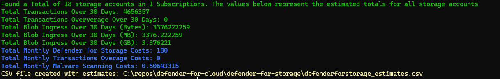

# Microsoft Defender for Storage – Price Estimation Scripts

- [Defender for Storage Overview](#defender-for-storage-overview)
- [PowerShell Scripts](#powershell-scripts)
  * [get-azStorageMetrics.ps1](#get-azstoragemetricsps1)
    + [Examples](#examples)
      - [Get estimates for all storage accounts in the Tenant](#get-estimates-for-all-storage-accounts-in-the-tenant)
      - [Get estimates for all storage accounts in a management group you specify](#get-estimates-for-all-storage-accounts-in-a-management-group-you-specify)
      - [Get estimates for all storage accounts in Subscriptions you specify](#get-estimates-for-all-storage-accounts-in-subscriptions-you-specify)
      - [Get estimates for all storage accounts in a resource group you specify](#get-estimates-for-all-storage-accounts-in-a-resource-group-you-specify)
      - [Get estimates for a single storage account](#get-estimates-for-a-single-storage-account)
  * [DefenderForStorage-CostEstimation-ResourceLevelVisibility.ps1](#defenderforstorage-costestimation-resourcelevelvisibilityps1)
    + [Requirements](#requirements)
    + [Run the estimator](#run-the-estimator)
    + [CSV output](#csv-output)
    + [Pricing and model limitations](#pricing-and-model-limitations)

> [!NOTE]
> A new pricing plan is now available for Microsoft Defender for Cloud that charges you according to the number of storage accounts it protects (per-storage account).
> The cost in the legacy pricing plan increases according to the number of analyzed transactions in the storage account (per-transaction).
> The new per-storage account plan fixes costs per storage account but accounts with an exceptionally high transaction volume incur an overage charge.
> For details about the pricing plans, see [Microsoft Defender for Cloud pricing page](https://azure.microsoft.com/pricing/details/defender-for-cloud/)
>
> The new per-storage plan is only supported on public clouds, and can be enabled only at the subscription level.

## Recommended workbook

> [!IMPORTANT]
> You can also leverage the [Microsoft Defender for Storage pricing estimation workbook](https://github.com/Azure/Microsoft-Defender-for-Cloud/tree/main/Workbooks/Microsoft%20Defender%20for%20Storage%20Price%20Estimation)
>
> **Credits:** [Fernanda Vela](https://www.linkedin.com/in/mfvelah/), [Aviv Shitrit](https://github.com/t-ashitrit), [Eitan Shteinberg](https://www.linkedin.com/in/eitan-shteinberg/), [Shay Amar](https://www.linkedin.com/in/shay-amar/), [Dick Lake](https://www.linkedin.com/in/richard-lake-b3797394/)

## Defender for Storage Overview
Microsoft Defender for Storage is an Azure-native layer of security intelligence that detects potential threats to your storage accounts. It helps prevent the three major impacts on your data and workload: malicious file uploads, sensitive data exfiltration, and data corruption.

Microsoft Defender for Storage provides comprehensive security by analyzing the data plane and control plane telemetry generated by Azure Blob Storage, Azure Files, and Azure Data Lake Storage services. It uses advanced threat detection capabilities powered by Microsoft Threat Intelligence, Microsoft Defender Antivirus, and Sensitive Data Discovery to help you discover and mitigate potential threats.

Defender for Storage includes:

- Activity Monitoring
- Sensitive data threat detection (preview feature, new plan only)
- Malware Scanning (new plan only)

For a full overview refer to [Overview of Microsoft Defender for Storage](https://learn.microsoft.com/azure/defender-for-cloud/defender-for-storage-introduction)

## PowerShell Scripts

These PowerShell scripts allow you to estimate the cost of the new per-storage pricing plan and it considers all storage accounts with and without Microsoft Defender for Storage enabled across the selected scope.

- **get-azStorageMetrics.ps1** will get estimated metrics on Azure Storage V2 Accounts to help estimate costs for Defender for Storage and Defender for Storage Malware Scanning

- **D4Storage-PricingEstimation-Per-Storage.ps1** executes in serial across each subscription and storage account whereas D4Storage-PricingEstimation-Per-Storage-Parallel.ps1 iterates over each subscription and storage account in parallel.

- **[DefenderForStorage-CostEstimation-ResourceLevelVisibility.ps1](./DefenderForStorage-CostEstimation-ResourceLevelVisibility.ps1)** estimates the base plan, transaction overage, and on-upload malware scanning with per-account CSV output and bounded parallelism.

### get-azStorageMetrics.ps1

This script will get estimated metrics on Azure Storage V2 Accounts to help estimate costs for Defender for Storage and Defender for Storage Malware Scanning
- The metrics used in this script is based on the last 30 days
- The price calculations are based on list price
- The script will output the totals and export the data to a csv file

#### Examples

##### Get estimates for all storage accounts in the Tenant
```powershell
.\get-azStorageMetrics.ps1 -all
```
##### Get estimates for all storage accounts in a management group you specify
```powershell
.\get-azStorageMetrics.ps1 -managementGroupName "Finance" 
```
##### Get estimates for all storage accounts in Subscriptions you specify
```powershell
# Single Subscription
.\get-azStorageMetrics.ps1 -subscriptionId '98aaxxab-0ef8-48e2-8397-a0101e0712e3'
# Multiple Subscriptions
.\get-azStorageMetrics.ps1 -subscriptionId '98aaxxab-0ef8-48e2-8397-a0101e0712e3,adaxxe68-375e-4210-be3a-c6cacebf41c5'
```
##### Get estimates for all storage accounts in a resource group you specify
```powershell
.\get-azStorageMetrics.ps1 -resourceGroupName "production accounts" -subscriptionId 'adaxxe68-375e-4210-be3a-c6cacebf41c5'
```
##### Get estimates for a single storage account
```powershell
.\get-azStorageMetrics.ps1 -storageAccountName "customeruploads" -resourceGroupName 'production accounts' -subscriptionId 'adaxxe68-375e-4210-be3a-c6cacebf41c5'
```



### DefenderForStorage-CostEstimation-ResourceLevelVisibility.ps1

**Version 4.2**

Use this [estimator](./DefenderForStorage-CostEstimation-ResourceLevelVisibility.ps1) for large scopes or workbook timeouts. It projects a usage sample to a **30-day forecast**, including accounts where protection is not enabled.
It handles pagination and bounded parallelism without changing Azure resources, and restores your Azure context afterward.

#### Requirements

Use **PowerShell 7+**, `Az.Accounts`, and Reader access to the selected scope.

#### Run the estimator

Download the script and run from this directory:

```powershell
Install-Module Az.Accounts -Scope CurrentUser
Connect-AzAccount -TenantId '<tenant-id>'

# All accessible, enabled subscriptions in the signed-in tenant.
.\DefenderForStorage-CostEstimation-ResourceLevelVisibility.ps1

# Selected subscriptions, a 30-day sample, and a modeled scanning cap.
.\DefenderForStorage-CostEstimation-ResourceLevelVisibility.ps1 `
    -SubscriptionIds '<subscription-id-1>,<subscription-id-2>' `
    -SampleDays 30 -ThrottleLimit 5 -MalwareScanningCapGB 10000
```

The default sample is seven days. `-OutputPath` changes the default `CostEstimation.csv`.
Console messages show the standard workbook title/version and label the modeled cap in GB/month per storage account.

#### CSV output

Output has one row per account, with totals printed separately.
`StorageAccountCost` is base plus overage; `MalwareScanningCost` is separate; `EstimatedMonthlyCost` includes both. `OldEstimateCost` is the legacy-plan comparison.

Existing CSV column names and order are retained; the new upload-volume fields are appended.
All monetary CSV fields retain raw decimal precision, including `OverageCost`, so sub-cent charges
are not lost when accounts are aggregated. Round only the final account or scope amount for display,
not the components before summing. The console rounds the final scope total (or known-cost subtotal)
to two decimal places. For example, 1,000 accounts with 10,000 overage transactions each at
$0.1492/million total $10,001.49 including the $10/account base charge, not $10,000.00.

| Field | Meaning |
| --- | --- |
| EstimatedMonthlyUploadedBytes | Numeric, uncapped monthly upload forecast in bytes. |
| EstimatedMonthlyUploaded | The same forecast with automatic B/KB/MB/GB/TB/PB/EB display units. |
| EstimatedMonthlyIngressGB | Existing numeric, uncapped upload forecast in GB. |
| MalwareScanningBillableGB | Modeled scanning volume after the optional cap, not measured or invoiced GB. |

Use numeric byte/GB values, not the display string, for sorting and totals. Applying a scanning cap does not reduce the reported upload forecast.
Missing or incomplete upload metrics leave both new volume fields blank, not `0 B`.

Missing metrics produce warnings, blank affected costs, and `MetricsStatus=Incomplete`. Such subtotals are **not complete scope totals**.
Any returned empty series or missing/null total makes that entire metric unavailable, even when other observations contain numeric totals. Partial sums are not projected as complete estimates; numeric zero totals remain valid observations.
HTTP/authentication failures stop the script without exporting a new report.

#### Pricing and model limitations

| Component | Default estimate (USD) |
| --- | --- |
| Base plan | 10/account/month |
| Transaction overage | 0.1492/million above 73 million/account/month |
| On-upload scanning | 0.15/GB |

Override `-CostPerStorageAccount`, `-PricePer1MOverageTransactions`, and `-MalwareScanningPricePerGB` for your agreement.
Check [current pricing](https://azure.microsoft.com/pricing/details/defender-for-cloud/); estimates are not invoices or quotes.

- Transactions cover Blob and File services; scanning uses **Blob upload ingress only** (1 GB = 1,073,741,824 bytes).
  The upload API filter matches the workbook: `PutBlob`, `CopyBlob`, `PutBlock`, `PutBlockList`,
  `PutBlockFromURL`, `AppendFile`, `FlushFile`, and `CreatePathFile`.
  Filtered requests disable dimension-value validation so APIs absent on an account do not
  cause HTTP 400; missing metric observations still produce incomplete estimates, not zero.
  Ingress is a proxy: repeated commits, copies, exclusions, and unsupported blobs can change actual scan volume.
- The script excludes on-demand scanning and additional Storage read, blob-index, and Event Grid charges.
  See [scanning behavior](https://learn.microsoft.com/azure/defender-for-cloud/on-upload-malware-scanning).
- Scanning is modeled as uncapped by default (`-MalwareScanningCapGB -1`). Setting a cap changes the estimate, not Azure settings.
  This is a scenario input, not discovery of configured per-account caps or a guaranteed invoice ceiling.

For manual import or ARM deployment, see the [workbook README](../../Workbooks/Microsoft%20Defender%20for%20Storage%20Price%20Estimation/README.md).
