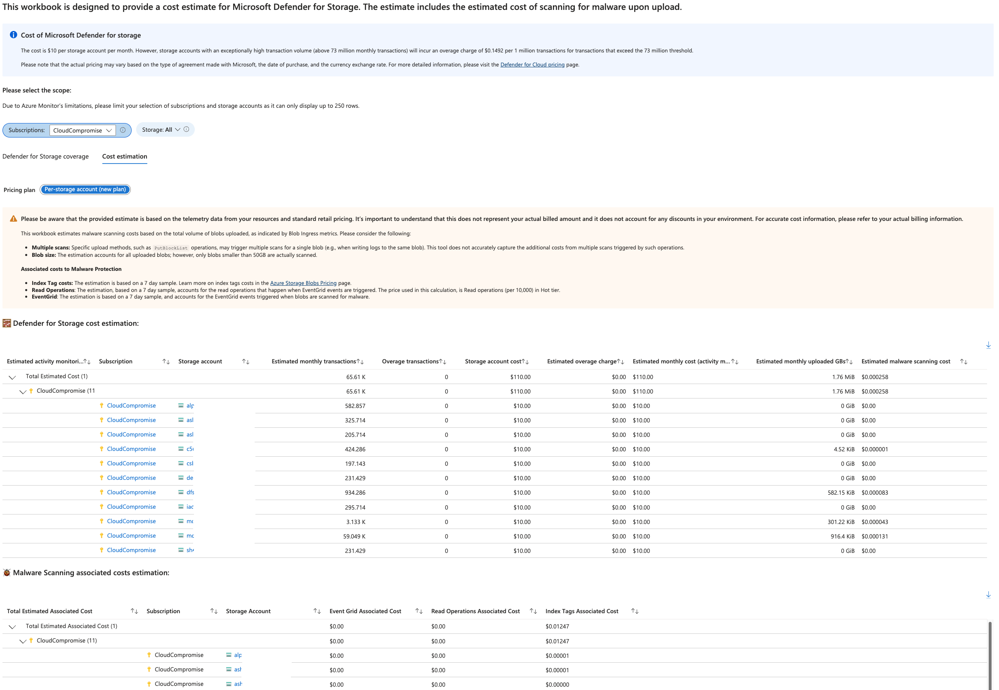

# Microsoft Defender for Storage - Price Estimation

**Version 4.3** | [Version history](#version-history)

Estimate **30-day costs from seven days of usage** for Defender for Storage and on-upload malware scanning, including accounts where protection is not yet enabled.
Associated-cost details use the seven-day sample and are not included in those monthly totals.

Creating or importing this workbook does not enable paid Defender plans or scanning.

## Views

| Tab | Contents |
| --- | --- |
| Defender for Storage coverage | Subscription coverage, plan status, and scanning settings. |
| Storage costs | Monthly activity-monitoring and on-upload malware-scanning estimates. |
| Scanning costs | Additional Event Grid, read-operation, and index-tag estimates from the seven-day sample. |

**Scanning costs** contains associated-charge details; the monthly on-upload malware-scanning estimate remains in **Storage costs**.

### Loading and shared data

All workbook groups explicitly use `loadType: always`, so their content is created when the workbook opens. Tab selection still controls visibility, but no longer defers group initialization.

The cost views share the same selected subscriptions, storage accounts, time range, and activity-metric source. The activity source is defined once, not duplicated for each tab.
The activity-metric source, blob-count source, and both cost tables initialize upfront. Required scope parameters and the seven-day sample still apply to queries.

Eager initialization can require more initial work. Scope changes can refresh both cost views, and metric reuse depends on portal caching. Large selections can still time out.

**In trial** shows **Yes** when trial time remains, **No** when the reported remaining time is zero (`PT0S`), and **Unknown** when trial data is unavailable.

**Estimated monthly transactions** and **Overage transactions** use automatic count units (K/M/B).
**Estimated monthly uploaded** uses automatic size units (MB/GB/TB). **Malware scanning cap (GB/month)** is the monthly limit per storage account.
Display units do not change numeric sorting, totals, or the GB-based scanning-cost calculation.

**Monthly activity monitoring cost** and **Monthly malware scanning cost** are monthly estimates displayed as USD with two decimal places, matching the storage account cost and overage charge columns.

Associated-cost columns use USD with **2-7 decimal places**, not automatic count units. This preserves readable sub-cent amounts: one modeled read operation is **$0.0000005**. Account values, subscription subtotals, and grand totals remain numeric; formatting does not change usage, rates, or aggregation precision.

## Workbook files

| File | Use |
| --- | --- |
| [D4StorageDeployment.json](./D4StorageDeployment.json) | Paste-ready workbook JSON for the Advanced Editor. |
| [armTemplate.json](./armTemplate.json) | ARM template for deploying a saved workbook. |
| [D4StorageARMTemplate.json](./D4StorageARMTemplate.json) | Backward-compatible ARM deployment path; identical copy of `armTemplate.json`. |

The workbook header links to the published GitHub README for usage guidance and version history.

## Manual import with the Advanced Editor

1. Open [D4StorageDeployment.json](./D4StorageDeployment.json), select **Raw**, and copy the entire JSON.
2. Open **Microsoft Defender for Cloud > Workbooks > New > Advanced Editor (</>)**, or **Edit > Advanced Editor** on an existing workbook.
3. Choose **Workbook Template** (**Gallery Template** in some portal versions), replace the editor contents, and select **Apply > Done Editing > Save**.

**No conversion or extraction is required.** Paste the standalone workbook JSON, not [armTemplate.json](./armTemplate.json).

## Deploy to Azure

<a href="https://portal.azure.com/#create/Microsoft.Template/uri/https%3A%2F%2Fraw.githubusercontent.com%2FAzure%2FMicrosoft-Defender-for-Cloud%2Frefs%2Fheads%2Fmain%2FWorkbooks%2FMicrosoft%2520Defender%2520for%2520Storage%2520Price%2520Estimation%2FarmTemplate.json" target="_blank"></a>

1. Select the button, sign in, and choose a subscription, resource group, and region.
2. Keep `workbookSourceId` as `azure security center`, then select **Review + create > Create**.
3. Open the saved workbook under **Microsoft Defender for Cloud > Workbooks** and select your scope.

Importing JSON does not rename an existing saved workbook; update its saved name separately.

**Permissions:** workbook deployment/write access to the resource group, plus read access to selected subscriptions, storage accounts, and metrics.

The button uses upstream `main`. Previously published links to `D4StorageARMTemplate.json` remain supported and deploy the same workbook. Alternatively, upload either ARM template through **Deploy a custom template > Build your own template in the editor**.

## Maintaining the workbook JSON

Keep the standalone workbook JSON structurally equivalent to the decoded JSON in `variables.workbookDataBase64` in both ARM templates. JSON whitespace differs; byte-for-byte identity with the standalone file is not required.
ARM decodes that UTF-8 payload into `resources[0].properties.serializedData` with `base64ToString` during deployment. This keeps valid workbook `null` values and empty arrays separate from ARM-template validation without removing them or suppressing checks.
The separate workbook/deployment layout is intentional: retain the paste-ready workbook so manual import never requires extracting `serializedData`. `armTemplate.json` is the canonical deployment envelope; `D4StorageARMTemplate.json` is its byte-identical compatibility copy. Update both in the same change; never replace the legacy path with standalone workbook JSON or a redirect that ARM cannot deploy.

For maintainers only, regenerate the encoded payload from this directory after editing the standalone workbook; keep the deployment's `base64ToString` expression intact:

```powershell
$workbookJson = Get-Content .\D4StorageDeployment.json -Raw | ConvertFrom-Json -Depth 100 | ConvertTo-Json -Depth 100 -Compress
$template = Get-Content .\armTemplate.json -Raw | ConvertFrom-Json -Depth 100
$template.variables.workbookDataBase64 = [Convert]::ToBase64String([Text.Encoding]::UTF8.GetBytes($workbookJson))
$template | ConvertTo-Json -Depth 100 | Set-Content .\armTemplate.json -Encoding utf8
Copy-Item .\armTemplate.json .\D4StorageARMTemplate.json
```

Validate the standalone workbook against the workbook schema, decode the payload and compare its JSON, and validate the ARM envelope separately.

Run the repository's existing checks from the repository root with `npm test`.
For workbook changes, also verify both ARM paths, decoded payload parity, and upload API parity with
the PowerShell estimator. Exercise sub-cent component and multi-account cost aggregation with mocked
metrics before publishing; offline checks do not replace authenticated portal validation.

## PowerShell estimation at scale

For large scopes or timeouts, use the [PowerShell estimator](../../Powershell%20scripts/Storage%20Price%20Estimation%20Script/DefenderForStorage-CostEstimation-ResourceLevelVisibility.ps1).
It also reports automatic upload-size units while preserving numeric byte/GB fields for sorting and totals.
See its [README](../../Powershell%20scripts/Storage%20Price%20Estimation%20Script/README.md#defenderforstorage-costestimation-resourcelevelvisibilityps1) for prerequisites, examples, CSV fields, and pricing options.

## Pricing and limitations

- Estimates are not invoices or quotes; check [current pricing](https://azure.microsoft.com/pricing/details/defender-for-cloud/) and your agreement.
- Upload ingress is a proxy for scanned volume, not measured scanning or billing data. Review incomplete or errored results before using totals.
- The coverage cap is informational; workbook scanning-cost estimates do not apply it. The PowerShell estimator offers a separate modeled cap.
- Large scopes can be truncated or time out. Narrow the selection or use PowerShell; partial results are not tenant-wide totals.

## Troubleshooting

**No "matrix" implementation available** in **Read Operations Associated Cost** is a workbook formula-evaluation error, not a malware finding or an account protection status.
Earlier copies wrapped the entire read-operation expression in square brackets, incorrectly requesting a matrix instead of a numeric cost.
Both affected calculated columns now use `(["eventgrid"] / 10000) * 0.005`; the brackets around the column reference are required.

Only rows that evaluate the faulty expression show the error. Rows that take the existing empty-metric fallback can show `$0.00` instead; small calculated amounts can also round to `$0.00`.
Neither an empty-metric fallback nor a rounded display confirms zero billable usage.

If a saved workbook still shows the message, reimport the updated [standalone workbook JSON](./D4StorageDeployment.json), or redeploy the updated [ARM template](./armTemplate.json).
Until corrected, treat affected costs as **Not calculated**, not zero, and related totals as incomplete.

### Long read-operation totals or scientific notation

Older copies mixed text `"0"` results with numeric costs, causing grouped sums to concatenate values into long strings, sometimes containing `e-7`. Those strings are not valid charges.
All Event Grid, read-operation, and index-tag zero-cost branches now return numeric expressions before aggregation. Both merge surfaces use consistent USD formatting with up to seven decimals, while retaining full numeric values for sums.
The scientific value `5e-7` by itself is only **$0.0000005**, not a large cost. Reimport the updated workbook or redeploy the ARM template to correct existing saved copies.

## Overview



**Credits:** [Eitan Shteinberg](https://www.linkedin.com/in/eitan-shteinberg/), [Fernanda Vela](https://www.linkedin.com/in/mfvelah/), [Shay Amar](https://www.linkedin.com/in/shay-amar/)

## Version history

| Version | Changes |
| --- | --- |
| 4.3 | Added **Storage costs** and **Scanning costs** tabs with eager initialization and shared data. Fixed metric completeness and numeric cost totals; added readable USD precision, guide links, and version history. ARM deployment decodes a base64 workbook payload; standalone import stays paste-ready. |
| 4.2 | Added paste-ready workbook JSON and a separate ARM deployment template, clearer count and size units, consistent USD cost formatting and headings, explicit trial statuses, and the PowerShell estimator workflow. Corrected the matrix-producing read-operation formulas and explained calculation errors, incomplete totals, and zero-display caveats. |
